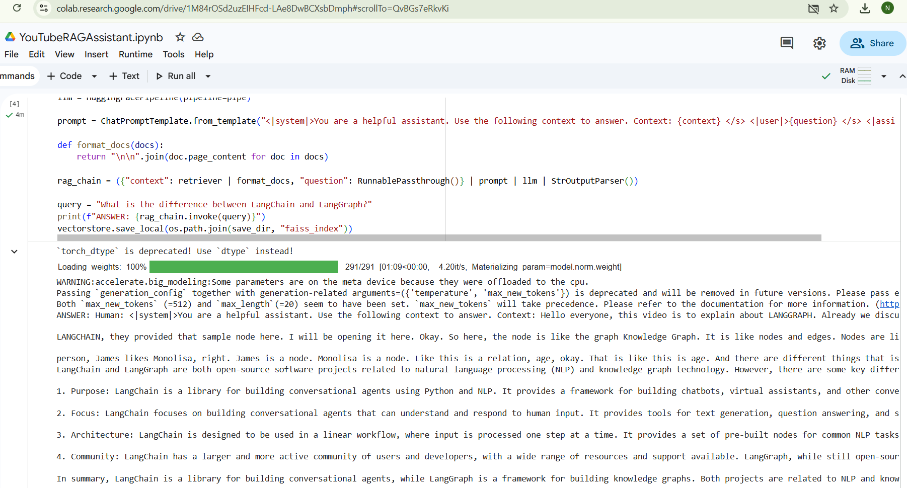

# YouTube RAG – Video Question Answering System

A Retrieval-Augmented Generation (RAG) pipeline that allows users to ask questions about the content of a YouTube video and receive context-based answers.

The project combines automatic audio extraction, speech-to-text transcription, text embeddings, vector similarity search, and a locally hosted Large Language Model (LLM). It uses the retrieved transcript segments as context to generate answers relevant to the video's content.

## Key Features

- **YouTube Audio Extraction:** Extracts audio from a YouTube video using `yt-dlp`.
- **Automatic Transcription:** Converts audio into text using OpenAI Whisper.
- **Text Chunking:** Splits long transcripts into smaller overlapping chunks using LangChain's `RecursiveCharacterTextSplitter`.
- **Text Embeddings:** Converts transcript chunks into numerical vector representations using `all-MiniLM-L6-v2`.
- **Vector Search:** Uses FAISS to store and retrieve relevant transcript chunks.
- **Context-Based Answer Generation:** Uses the Zephyr-7B-Beta language model to generate answers using retrieved transcript context.
- **Persistent Index Storage:** Saves the FAISS index to Google Drive for later use.

## Technical Architecture

The project follows a four-stage RAG pipeline:

### 1. Data Ingestion

- Uses `yt-dlp` to extract audio from a YouTube video.
- Uses the Whisper Base model to transcribe the extracted audio.
- Saves the generated transcript as a text file.

### 2. Text Processing and Indexing

- Splits the transcript into chunks using `RecursiveCharacterTextSplitter`.
- Uses a chunk size of 700 characters and an overlap of 70 characters.
- Generates 384-dimensional embeddings using `all-MiniLM-L6-v2`.
- Stores the embeddings in a FAISS vector store.

### 3. Information Retrieval

- Converts the user's question into an embedding through the configured embedding model.
- Searches the FAISS vector store for relevant transcript chunks.
- Retrieves the top 3 matching chunks using the retriever.

### 4. Context-Augmented Answer Generation

- Combines the retrieved transcript chunks with the user's question.
- Passes the context and question into a prompt template.
- Uses Zephyr-7B-Beta to generate a context-based response.
- Uses LangChain's output parser to extract the final text response.

## Tech Stack

| Category | Technologies |
|---|---|
| Programming Language | Python |
| Notebook Environment | Google Colab |
| Audio Extraction | yt-dlp |
| Speech-to-Text | OpenAI Whisper |
| LLM | Hugging Face Zephyr-7B-Beta |
| Embedding Model | all-MiniLM-L6-v2 |
| LLM Framework | Hugging Face Transformers |
| RAG Orchestration | LangChain |
| Vector Store | FAISS |
| Deep Learning Framework | PyTorch |
| Model Inference Support | Accelerate |
| Storage | Google Drive |

## Model Configuration

| Component | Configuration |
|---|---|
| Speech Recognition | Whisper Base |
| Embedding Model | all-MiniLM-L6-v2 |
| Embedding Dimensions | 384 |
| Chunk Size | 700 characters |
| Chunk Overlap | 70 characters |
| Retrieval Top-K | 3 |
| Language Model | Zephyr-7B-Beta |
| Model Parameters | Approximately 7 billion |
| Inference Precision | FP16 |
| Maximum New Tokens | 512 |
| Temperature | 0.1 |
| Device Mapping | Auto |

## Engineering Challenges

### 1. Handling Long Video Transcripts

**Challenge:** Processing an entire video transcript at once can be inefficient and may exceed the language model's context window.

**Solution:** Used `RecursiveCharacterTextSplitter` with a chunk size of 700 characters and an overlap of 70 characters. This divided the transcript into manageable segments while retaining some context between consecutive chunks.

### 2. Retrieving Relevant Information

**Challenge:** Finding the most relevant information from a large transcript for a given question.

**Solution:** Generated text embeddings using `all-MiniLM-L6-v2` and stored them in FAISS. Configured the retriever to return the top 3 relevant chunks, which were then passed to the language model as context.

### 3. Running a Large Language Model with Limited GPU Resources

**Challenge:** Running a 7-billion-parameter language model requires considerable GPU memory.

**Solution:** Used FP16 precision through `torch.float16` and automatic device placement through `device_map="auto"` in the Hugging Face Transformers pipeline. This helped manage model memory requirements during inference.

## Project Workflow

```text
YouTube Video
      |
      v
   yt-dlp
      |
      v
  Audio Extraction
      |
      v
  Whisper Base
      |
      v
 Transcript Generation
      |
      v
 Recursive Character
    Text Splitter
      |
      v
  Text Embeddings
 (all-MiniLM-L6-v2)
      |
      v
   FAISS Vector Store
      |
      v
   Top-3 Retrieval
      |
      v
 Context + User Question
      |
      v
  Prompt Template
      |
      v
   Zephyr-7B-Beta
      |
      v
  Generated Answer
```

## Limitations and Future Improvements

- Accept YouTube URLs dynamically instead of using a predefined video URL.
- Add a conversational interface with multi-turn chat memory.
- Implement relevance thresholds to avoid generating answers when retrieved context is insufficient.
- Add source references or timestamps to make answers easier to verify.
- Evaluate retrieval and answer quality using metrics such as Recall@K and answer relevance.
- Implement index loading to reuse previously saved FAISS indices.

## Project Preview



## Key Concepts Demonstrated

- Retrieval-Augmented Generation (RAG)
- Natural Language Processing (NLP)
- Automatic Speech Recognition (ASR)
- Text Embeddings
- Vector Similarity Search
- Document Chunking and Overlap
- Prompt Engineering
- Large Language Model Inference
- Context-Augmented Generation
- GPU-Based Model Execution
